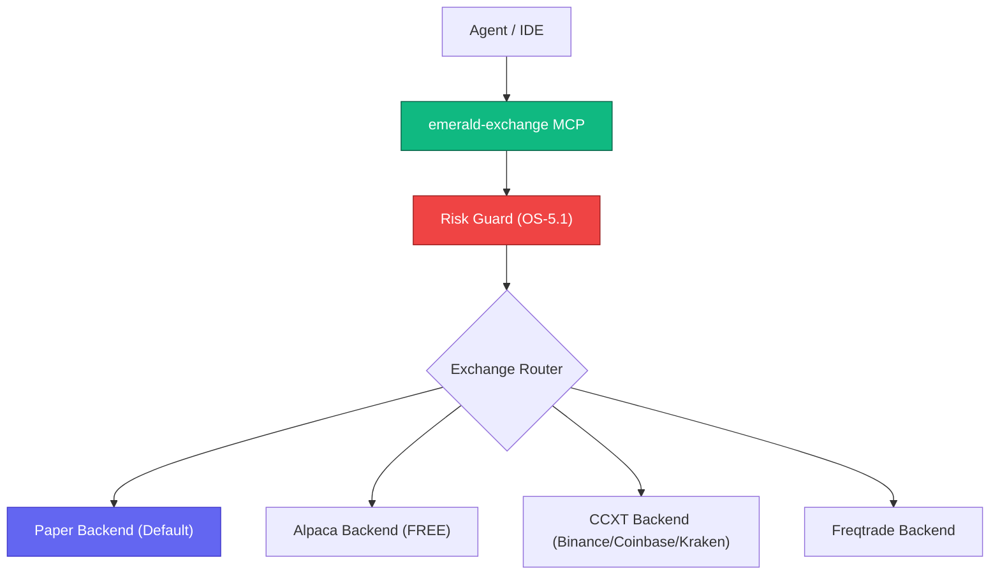

# Emerald Exchange - API | MCP | A2A


*Version: 2.3.6*

> **Documentation** — Installation, deployment, usage across the API, CLI, and MCP
> interfaces, the A2A agent server, and the trading configuration schema are
> maintained in the [official documentation](https://knuckles-team.github.io/emerald-exchange/).

## Overview

Emerald Exchange is a unified Finance MCP Server providing fully abstracted exchange backends
for equities, crypto, and derivatives trading. All trading feature is tool-driven via MCP,
with built-in financial hardening controls (OS-5.1).

**Key Features:**
- **5 Exchange Backends**: Paper (default), Alpaca (FREE), CCXT (100+ exchanges), Freqtrade
- **6 MCP Tool Domains**: market-data, orders, portfolio, risk, signals, strategy
- **Financial Hardening**: Paper-first default, Kelly criterion position sizing, circuit breakers, kill switch
- **Config-Driven**: All settings via `~/.config/agent-connectors/config.json`

## Architecture



## MCP Tools

_Auto-generated from the live MCP server — do not edit by hand._

<!-- MCP-TOOLS-TABLE:START -->

#### Trading, risk and analysis tools (one typed tool per operation)

| MCP Tool | Toggle Env Var | Description |
|----------|----------------|-------------|
| `emerald_crypto_arb_scan` | `CRYPTOTOOL` | Cross-exchange arbitrage scan between two venues. |
| `emerald_crypto_cointegration` | `CRYPTOTOOL` | Cointegration test between two crypto assets. |
| `emerald_crypto_funding_rates` | `CRYPTOTOOL` | Perpetual futures funding rate for a pair. |
| `emerald_crypto_on_chain` | `CRYPTOTOOL` | On-chain analytics (volume, active addresses) for an asset. |
| `emerald_crypto_whale_alerts` | `CRYPTOTOOL` | Large on-chain transfers above the alert threshold. |
| `emerald_debate_consensus` | `DEBATETOOL` | Debate consensus and outcome so far. |
| `emerald_debate_history` | `DEBATETOOL` | Past debates from the knowledge graph. |
| `emerald_debate_risk_veto` | `DEBATETOOL` | Risk officer veto: reject the hypothesis at once. |
| `emerald_debate_start` | `DEBATETOOL` | Start a new debate on a trading hypothesis. |
| `emerald_debate_submit_argument` | `DEBATETOOL` | Submit a bull or bear argument to an active debate. |
| `emerald_derivatives_calibrate` | `DERIVATIVESTOOL` | Calibrate SABR (alpha, rho, nu) to a market smile with beta fixed. |
| `emerald_derivatives_implied_vol` | `DERIVATIVESTOOL` | One-strike SABR implied vol. |
| `emerald_derivatives_smile` | `DERIVATIVESTOOL` | SABR implied-vol smile across strikes. |
| `emerald_derivatives_vol_arb` | `DERIVATIVESTOOL` | Rich/cheap strikes against the SABR-fair smile (decision only). |
| `emerald_fundamentals_filings` | `FUNDAMENTALSTOOL` | Latest N filings of a form. |
| `emerald_fundamentals_financials` | `FUNDAMENTALSTOOL` | Standardized financial statement. |
| `emerald_fundamentals_forensic_screen` | `FUNDAMENTALSTOOL` | Standardize then engine forensic_report: Beneish/Altman/Piotroski/Sloan verdict. |
| `emerald_fundamentals_full_text_search` | `FUNDAMENTALSTOOL` | EDGAR full-text phrase search. |
| `emerald_fundamentals_mdna` | `FUNDAMENTALSTOOL` | Item 7 MD&A, this year and prior year. |
| `emerald_fundamentals_risk_factors` | `FUNDAMENTALSTOOL` | Item 1A risk factors, this year and prior year. |
| `emerald_fundamentals_standardize` | `FUNDAMENTALSTOOL` | Two latest fiscal years in the 17-key forensic schema. |
| `emerald_ingest_snapshot` | `KG_INGESTTOOL` | Ingest a live trading snapshot into medulla as typed nodes. |
| `emerald_market_making_backtest` | `MARKET_MAKINGTOOL` | Event-driven L2-queue backtest — refused (not_served). |
| `emerald_market_making_brier` | `MARKET_MAKINGTOOL` | Brier calibration score of forecasts vs outcomes. |
| `emerald_market_making_fee` | `MARKET_MAKINGTOOL` | Venue fee for a fill — refused (not_served). |
| `emerald_market_making_forensic` | `MARKET_MAKINGTOOL` | Two-year forensic accounting screen. |
| `emerald_market_making_pbo` | `MARKET_MAKINGTOOL` | Probability of backtest overfit. |
| `emerald_market_making_quote` | `MARKET_MAKINGTOOL` | Intended market-making quotes for one book update (decision only). |
| `emerald_market_making_validate` | `MARKET_MAKINGTOOL` | Performance, deflated Sharpe and purged CPCV of backtest returns. |
| `emerald_orders_cancel` | `ORDERTOOL` | Cancel an open order. |
| `emerald_orders_halt` | `ORDERTOOL` | Emergency kill switch: halt ALL trading. |
| `emerald_orders_resume` | `ORDERTOOL` | Resume trading after a halt. |
| `emerald_orders_status` | `ORDERTOOL` | Status, filled quantity and average price of one order. |
| `emerald_orders_submit` | `ORDERTOOL` | Submit an order after the pre-trade risk check. |
| `emerald_prediction_markets_evaluate_event_arbitrage` | `PREDICTION_MARKETTOOL` | Dual-platform arbitrage evaluation using a Laplace-smoothed forecast. |
| `emerald_prediction_markets_fetch_kalshi_orderbook` | `PREDICTION_MARKETTOOL` | Fetch the Kalshi orderbook for an event (simulated via API). |
| `emerald_prediction_markets_fetch_open_meteo_ensemble` | `PREDICTION_MARKETTOOL` | Fetch the 31-member ensemble weather forecast for a location. |
| `emerald_prediction_markets_fetch_polymarket_orderbook` | `PREDICTION_MARKETTOOL` | Fetch the Polymarket orderbook for an event (simulated via API). |
| `emerald_risk_bayesian_kelly` | `RISKTOOL` | Beta-posterior Kelly sizing (engine-backed, uncertainty-aware). |
| `emerald_risk_daily_loss_check` | `RISKTOOL` | Check the daily loss against the configured limit. |
| `emerald_risk_drawdown_check` | `RISKTOOL` | Check portfolio drawdown against the configured limit. |
| `emerald_risk_empirical_kelly` | `RISKTOOL` | Monte-Carlo Kelly sizing over a realized return distribution. |
| `emerald_risk_kelly` | `RISKTOOL` | Point Kelly criterion position size. |
| `emerald_risk_limits` | `RISKTOOL` | The configured risk limits. |
| `emerald_risk_status` | `RISKTOOL` | Current risk status: halted, equity and peak equity. |
| `emerald_signals_alpha` | `SIGNALTOOL` | Alpha factors for a ticker. |
| `emerald_signals_fuse` | `SIGNALTOOL` | Bayesian signal fusion seeded from KG-stored signal priors. |
| `emerald_signals_insider_equilibrium` | `SIGNALTOOL` | Strategic insider equilibrium under DYNAMIC legal risk ( |
| `emerald_signals_regime` | `SIGNALTOOL` | Detect the current market regime (engine HMM over returns). |
| `emerald_signals_surveillance` | `SIGNALTOOL` | Kyle insider/stealth-trading surveillance scores ( |
| `emerald_statarb_dynamic_beta` | `STATARBTOOL` | Current Kalman hedge beta and its variance. |
| `emerald_statarb_ou_signal` | `STATARBTOOL` | OU stat-arb bands: {adf, ou, thresholds} from medulla. |
| `emerald_strategy_backtest` | `STRATEGYTOOL` | Validate a returns series (deflated Sharpe + PBO) and write the priors. |
| `emerald_strategy_export` | `STRATEGYTOOL` | Export a strategy to PineScript, MQL5 or TDX. |
| `emerald_strategy_list` | `STRATEGYTOOL` | Strategies from the knowledge graph. |
| `emerald_strategy_promote` | `STRATEGYTOOL` | Promote a strategy stage (draft -> backtest -> paper -> live). |
| `emerald_wallet_intel_exit_behavior` | `WALLET_INTELTOOL` | Share exited before resolution and average share of max profit captured. |
| `emerald_wallet_intel_rank_wallets` | `WALLET_INTELTOOL` | Smart-money copy-trade targets. |
| `emerald_wallet_intel_smart_money_convergence` | `WALLET_INTELTOOL` | How many target wallets hold the same side of a token. |
| `emerald_wallet_intel_wallet_profile` | `WALLET_INTELTOOL` | Per-wallet stats and open positions. |

#### Exchange read operations (one typed tool per API method)

| MCP Tool | Description |
|----------|-------------|
| `emerald_exchange_exchanges` | Available exchange backends, the active backend and its mode. |
| `emerald_exchange_get_account` | Account balances and buying power. |
| `emerald_exchange_get_account_positions` | Read positions with stable identities scoped to their Alpaca account. |
| `emerald_exchange_get_account_snapshot` | Read one Alpaca account and its positions as an ingestible record. |
| `emerald_exchange_get_company_records` | Read a bounded FMP company dataset for an Alpaca symbol. |
| `emerald_exchange_get_csv_activities` | Read validated statement rows for the active Alpaca account. |
| `emerald_exchange_get_exchange_history` | Read one bounded CCXT candle page with stable exchange identity. |
| `emerald_exchange_get_historical` | Historical OHLCV bars for one symbol. |
| `emerald_exchange_get_multi_asset_records` | Read bounded multi-asset provider observations. |
| `emerald_exchange_get_order_status` | Status of one submitted order. |
| `emerald_exchange_get_positions` | Open positions. |
| `emerald_exchange_get_quote` | Latest quote for one symbol. |
| `emerald_exchange_get_stock_bars` | Read one Alpaca page with explicit adjustment and feed labels. |
| `emerald_exchange_get_stock_dividends` | Read one bounded page of Alpaca corporate-action dividends. |
| `emerald_exchange_get_stock_news` | Read one bounded page of Alpaca news headlines. |
| `emerald_exchange_get_stock_quote` | Read an Alpaca quote with explicit feed and source time. |

_60 trading tool(s) · 16 exchange read tool(s). Each trading domain is enabled unless its `<DOMAIN>TOOL` toggle is set false. Submit, cancel and halt are destructive and ask for confirmation. Auto-generated — do not edit._
<!-- MCP-TOOLS-TABLE:END -->

## Exchange Backends

| Backend | Assets | Paper | Live | Free |
|---------|--------|-------|------|------|
| Paper | All | ✅ | — | ✅ |
| Alpaca | Equities, Crypto | ✅ | ✅ | ✅ |
| CCXT (Binance) | Crypto | ✅ | ✅ | ✅ |
| CCXT (Coinbase) | Crypto | ✅ | ✅ | ✅ |
| CCXT (Kraken) | Crypto | ✅ | ✅ | ✅ |
| Freqtrade | Crypto | ✅ | ✅ | ✅ |
| Prediction Markets (Kalshi/Polymarket) | Events/Weather | ✅ | ✅ | ✅ |

## Financial Hardening (OS-5.1)

| Control | Default |
|---------|---------|
| Trading Mode | Paper (must explicitly opt into live) |
| Max Position Size | 2% of portfolio (Kelly criterion) |
| Max Portfolio Drawdown | 10% auto-halt |
| Max Daily Loss | 3% auto-halt |
| Regime Shift Detection | KS-test auto-halt |
| Human Approval for Live | Required |
| Kill Switch | `emerald_orders_halt` (destructive; asks for confirmation) |

## Usage

### MCP Configuration

> **Install the slim `[mcp]` extra.** The examples below install
> `emerald-exchange[mcp]` — the MCP-server extra that pulls only the FastMCP /
> FastAPI tooling (`scion-sdk`). It deliberately **excludes** the heavy
> agent-orchestration runtime (`pydantic-ai`, `dspy`, `llama-index`, `tree-sitter`
> and the agent frontends), so `uvx`/container installs stay smaller and faster —
> note the mandatory `medulla[full]` engine is still present either way,
> since it is a base dependency of `scion-sdk` itself, not gated behind an
> extra. Use the full `[agent]` extra only when the operator need the integrated Pydantic AI
> agent (see [Installation](#installation)). Add trading-backend extras
> (`[alpaca]`, `[crypto]`, `[prediction_markets]`, …) on top as needed.

#### stdio Mode
```json
{
  "mcpServers": {
    "emerald-exchange": {
      "command": "uvx",
      "args": ["--from", "emerald-exchange[mcp]", "emerald-exchange-mcp"],
      "env": {}
    }
  }
}
```

#### Streamable HTTP Mode
```bash
emerald-exchange-mcp --transport streamable-http --port 8100
```

### Configuration

All trading settings are configured via `~/.config/agent-connectors/config.json`:

```json
{
  "trading": {
    "default_mode": "paper",
    "default_exchange": "alpaca",
    "exchanges": {
      "alpaca": {
        "enabled": true,
        "api_key_env": "ALPACA_API_KEY",
        "api_secret_env": "ALPACA_SECRET_KEY",
        "base_url": "https://paper-api.alpaca.markets"
      }
    },
    "risk_limits": {
      "max_position_pct": 0.02,
      "max_portfolio_drawdown_pct": 0.10,
      "max_daily_loss_pct": 0.03,
      "require_human_approval_live": true
    }
  }
}
```

<!-- BEGIN GENERATED: additional-deployment-options -->
### Additional Deployment Options

`emerald-exchange` can run as a local stdio process or container, or behind a remote
network boundary. The
[Deployment guide](https://knuckles-team.github.io/emerald-exchange/deployment/) carries
the detailed transport contract.

- **Local container** — launch a reviewed immutable image as a least-privilege
  stdio child with no listener or published port.
- **Remote URL** — connect through an operator-supplied authenticated HTTPS
  ingress. Keep its URL, outbound identity references, trust profile, and exact
  `MCP_ALLOWED_HOSTS` in `AgentConfig`.
<!-- END GENERATED: additional-deployment-options -->

## ⚙️ Dynamic Tool Selection & Visibility

This MCP server supports dynamic toolset selection and visibility filtering at runtime. This allows the operator to restrict the set of exposed tools to prevent blowing up the LLM's context window.

The operator can configure tool filtering via multiple input channels:

- **CLI Arguments:** Pass `--tools` or `--toolsets` (or their disabled counterparts `--disabled-tools` and `--disabled-toolsets`) during startup.
- **Environment Variables:** Define standard environment variables:
  - `MCP_ENABLED_TOOLS` / `MCP_DISABLED_TOOLS`
  - `MCP_ENABLED_TAGS` / `MCP_DISABLED_TAGS`
- **HTTP SSE Request Headers:** Pass custom headers during transport initialization:
  - `x-mcp-enabled-tools` / `x-mcp-disabled-tools`
  - `x-mcp-enabled-tags` / `x-mcp-disabled-tags`
- **HTTP SSE Request Query Parameters:** Append query parameters directly to the operator's transport connection URL:
  - `?tools=tool1,tool2`
  - `?tags=tag1`

When query strings or parameters are provided, an LLM-free **Knowledge Graph resolution layer** (using `DynamicToolOrchestrator`) matches query intents against known tool tags, names, or descriptions, with safe fallback and automated 24-hour background cache refreshing.


---

## Installation

Pick the extra that matches what the operator want to run, then layer trading-backend extras on top:

| Extra | Installs | Use when |
|-------|----------|----------|
| `emerald-exchange[mcp]` | Slim MCP server (`scion-sdk` — FastMCP/FastAPI; still carries the mandatory `medulla[full]` base engine) + paper backend | The operator only run the **MCP server** (smallest install / image) |
| `emerald-exchange[agent]` | Full agent runtime (`scion-sdk` — Pydantic AI/DSPy orchestration + `medulla[full]`) | The operator run the **integrated agent** |
| `emerald-exchange[all]` | Everything (`mcp` + `agent` + every trading backend) | Development / full surface |

```bash
pip install "emerald-exchange[mcp]"                # MCP server only (slim deps)
pip install "emerald-exchange[agent]"              # Full agent runtime (Pydantic AI + engine)
pip install "emerald-exchange[mcp,alpaca]"         # + Alpaca equities
pip install "emerald-exchange[mcp,crypto]"         # + CCXT crypto
pip install "emerald-exchange[mcp,prediction_markets]"  # + Kalshi & Polymarket
pip install "emerald-exchange[all]"                # Everything
```

Alpaca operators can stream live quotes and raw minute bars into an SDK
`StreamBus` with `AlpacaBackend.stock_stream(bus, symbols, feed=..., license_tag=...)`.
Subscribe to `market.<symbol>.quotes` and `market.<symbol>.bars` before running
the returned stream's blocking `run()` in a dedicated thread; call `stop()` from
another thread to shut it down. Updated bars use the same identity and set
`updated` to true. Feed and licensing labels remain explicit. The live stream
does not backfill gaps after reconnect; reconcile with stock history as needed.

For historical one-minute IEX or SIP bars, set `session_scope` to
`alpaca_calendar` to label bars using the Alpaca exchange calendar. Labels
distinguish pre-market, regular, post-market, and outside-session minutes;
half-days and holidays follow the returned calendar and Alpaca's schedule.
Other feeds and wider bars refuse this classification. The default remains
`feed_native`, which makes no session claim.

To use company profile, income statement, earnings and logo sources alongside
Alpaca, configure `fmp_api_key_env` in the Alpaca exchange settings to name the
environment variable containing a Financial Modeling Prep API key. The key is
sent in a request header, not the URL. Each source requires an operator-provided
license tag; the operator must ensure their FMP subscription permits the intended
use. The returned snapshot is bounded and does not claim complete historical
coverage or real-time availability. Logo data is returned only when FMP names
the expected symbol image and does not mark it as a default image.

Multi-asset source snapshots use `FMP_API_KEY` for FX, `DATABENTO_API_KEY`
for commodity spot or a specific outright futures contract, and `ATTOM_API_KEY`
for property valuations. Set the keys in the server environment. The declared
sources accept a tenant, source identity and operator-supplied license tag. FX
preserves base/quote direction; commodity requests return at most one trade
with its matching instrument definition for a range of at most one day. Fixed
futures contracts carry the provider expiry and an explicit no-roll policy.
ATTOM uses a property ID and reports its valuation date and age against the
chosen `max_age_days`. Sources are delta observations, not complete histories.
Twelve Data provides a separate XAU/USD gold spot source; its timestamp is
the last one-minute candle timestamp, not an individual trade time. Provider
subscriptions may charge for requests; access and permitted use depend
on the operator's agreements. Offline fixtures are not evidence of live rights.

## Docker

### Container images (`:mcp` vs `:agent`)

One multi-stage `docker/Dockerfile` builds two right-sized images, selected by `--target`:

| Image tag | Build target | Contents | Entrypoint |
|-----------|--------------|----------|------------|
| `knucklessg1/emerald-exchange:mcp` | `--target mcp` | `emerald-exchange[mcp]` — **slim**: no `pydantic-ai`/`dspy`/`llama-index`/`tree-sitter` agent-orchestration stack (the mandatory `medulla[full]` engine is still present — it's a base dependency of `scion-sdk`) | `emerald-exchange-mcp` |
| `knucklessg1/emerald-exchange:2.3.6` | `--target agent` (default) | `emerald-exchange[agent]` — **full** agent runtime (`scion-sdk`) + `medulla[full]` | `emerald-exchange-agent` |

```bash
docker build --target mcp   -t knucklessg1/emerald-exchange:mcp    docker/   # slim MCP server
docker build --target agent -t knucklessg1/emerald-exchange:2.3.6 docker/   # full agent
docker compose -f docker/mcp.compose.yml up -d                               # run the slim :mcp server
docker compose -f docker/compose.yml up -d                                   # full stack
```

### Knowledge-graph database (`medulla`)

Both `[mcp]` and `[agent]` carry the **medulla** engine through the required
Scion SDK core dependency (`medulla[full]`) — it is a mandatory base
dependency of `scion-sdk`, not gated behind an extra. The `[mcp]` extra keeps
the server slim/connector-focused (no agent-orchestration stack); `[agent]`
also enables Pydantic AI/DSPy model orchestration. Local deployments can use
the bundled engine. For production — or to share one knowledge graph across multiple
agents — run **medulla as its own dedicated database service** and point the
runtime at it instead of embedding it. Deployment recipes (single-node + Raft HA),
connection configuration, and the full database architecture (with diagrams) are
documented in the
[medulla deployment guide](https://knuckles-team.github.io/medulla/deployment/).

## Documentation

The complete documentation is published as the
[official documentation site](https://knuckles-team.github.io/emerald-exchange/) and is the
recommended reference for installation, deployment, and day-to-day operation.

| Page | Contents |
|---|---|
| [Installation](https://knuckles-team.github.io/emerald-exchange/installation/) | pip, source, extras, prebuilt Docker image |
| [Deployment](https://knuckles-team.github.io/emerald-exchange/deployment/) | run the MCP and agent servers, Compose, Caddy + Technitium, env config |
| [Usage](https://knuckles-team.github.io/emerald-exchange/usage/) | the MCP tools, the Python API, the cockpit CLI |
| [Overview](https://knuckles-team.github.io/emerald-exchange/overview/) | enterprise features, tool surface, architecture |
| [Configuration Schema](https://knuckles-team.github.io/emerald-exchange/config_schema/) | the `trading` config block and backend matrix |
| [Concepts](https://knuckles-team.github.io/emerald-exchange/concepts/) | concept registry (`CONCEPT:EE-*`) |

`AGENTS.md` is the canonical contributor/agent guidance.


<!-- BEGIN agent-os-genesis-deploy (generated; do not edit between markers) -->

## Deploy with `agent-os-genesis`

This package can be provisioned for you — skill-guided — by the **`agent-os-genesis`**
universal skill (its *single-package deploy mode*): it picks your install method, seeds
secrets to OpenBao/Vault (or `.env`), trusts your enterprise CA, registers the MCP
server, and verifies it — the same machinery that stands up the whole Agent OS, narrowed
to just this package. Ask your agent to **"deploy `emerald-exchange` with agent-os-genesis"**.

| Install mode | Command |
|------|---------|
| Bare-metal, prod (PyPI) | `uvx emerald-exchange-mcp` · or `uv tool install emerald-exchange` |
| Bare-metal, dev (editable) | `uv pip install -e ".[all]"` · or `pip install -e ".[all]"` |
| Container, prod | deploy `knucklessg1/emerald-exchange:2.3.6` via docker-compose / swarm / podman / podman-compose / kubernetes |
| Container, dev (editable) | deploy `docker/compose.dev.yml` (source-mounted at `/src`; edits live on restart) |

Secrets are read-existing + seeded via `vault_sync` — you are only prompted for what's missing.

<!-- END agent-os-genesis-deploy -->

### Single-package self-setup: `deployment`

For a `tiny`/`single-node-prod` profile scoped to just this package (no whole-homelab
genesis), the **`deployment`** skill runs the equivalent
install-mode/secrets/doctor/registration/observability/rollback sequence. Ask the operator's
agent to **"deploy `emerald-exchange` with deployment"**.

| Install mode | Command |
|------|---------|
| Installed package | `uv tool install "emerald-exchange[mcp]"`, then run `emerald-exchange-mcp` |
| Editable source | `uv pip install -e ".[agent]"`, then run `emerald-exchange-mcp` |
| Immutable container | deploy `knucklessg1/emerald-exchange:2.3.6` through the operator-selected orchestrator |

Either path: the repository embeds no deployment profile, credential value,
certificate path, or environment-specific endpoint. Runtime secrets, TLS trust
material, and endpoints come from `AgentConfig` / the configured secret provider
(OpenBao or `.env`), never from a committed file.

## Environment Variables

<!-- ENV-VARS-TABLE:START -->

#### Package environment variables

| Variable | Example | Description |
|----------|---------|-------------|
| `ATTOM_API_KEY` | secret-injected | ATTOM property valuation API key. |
| `DATABENTO_API_KEY` | secret-injected | Databento historical market data API key. |
| `FMP_API_KEY` | secret-injected | Financial Modeling Prep FX API key. |
| `TWELVE_DATA_API_KEY` | secret-injected | Twelve Data gold spot API key. |
| `BINANCE_API_KEY` | secret-injected | Per-exchange credentials are resolved at runtime from the trading config's *_env keys; only the scion-sdk-inherited Binance pair is read statically. Other exchanges (Alpaca, Coinbase, ...) supply credentials via operator config. |
| `BINANCE_SECRET_KEY` | secret-injected |  |
| `CRYPTOTOOL` | `True` | crypto market tools |
| `DEBATETOOL` | `True` | multi-agent debate tools |
| `DERIVATIVESTOOL` | `True` | options/futures derivatives tools |
| `FUNDAMENTALSTOOL` | `True` | SEC/EDGAR fundamentals tools |
| `MARKET_DATATOOL` | `True` | market-data tools |
| `MARKET_MAKINGTOOL` | `True` | market-making tools |
| `ORDERTOOL` | `True` | order placement/management tools |
| `PORTFOLIOTOOL` | `True` | portfolio tools |
| `PREDICTION_MARKETTOOL` | `True` | prediction-market tools |
| `RISKTOOL` | `True` | risk tools |
| `SIGNALTOOL` | `True` | signal tools |
| `STATARBTOOL` | `True` | statistical-arbitrage tools |
| `STRATEGYTOOL` | `True` | strategy tools |
| `WALLET_INTELTOOL` | `True` | Polymarket wallet-intelligence tools |
| `KG_INGESTTOOL` | `True` | knowledge-graph ingest tools |
| `EDGAR_IDENTITY` | `Your Name your.email@example.com` | SEC EDGAR identity ("Name email") |
| `EDGAR_USER_AGENT` | `Your Name your.email@example.com` | legacy fallback for EDGAR_IDENTITY |
| `POLY_TRADES_PATH` | `/path/to/poly_trades.parquet` | Polymarket trade dataset for wallet-intel |
| `EMERALD_STAGE_APPROVAL_TOKEN` | secret-injected | human approval token to promote execution stage |
| `MEDULLA_SOCKET` | `/run/medulla.sock` | UDS path to the medulla engine |
| `GRAPH_SERVICE_SOCKET` | `/run/medulla.sock` | alternate UDS path env var |
| `MEDULLA_TCP` | `127.0.0.1:50051` | host:port for a TCP engine endpoint |

#### Inherited scion-sdk variables (apply to every connector)

| Variable | Example | Description |
|----------|---------|-------------|
| `TRANSPORT` | `stdio` | MCP transport: `stdio` \| `streamable-http` \| `sse` |
| `HOST` | `127.0.0.1` | Loopback bind host (set an authenticated ingress explicitly) |
| `PORT` | `8000` | Bind port (HTTP transports) |
| `MCP_TOOL_MODE` | `intent` | Tool surface: `intent` \| `condensed` \| `verbose` \| `both` |
| `MCP_ENABLED_TOOLS` | — | Comma-separated tool allow-list |
| `MCP_DISABLED_TOOLS` | — | Comma-separated tool deny-list |
| `MCP_ENABLED_TAGS` | — | Comma-separated tag allow-list |
| `MCP_DISABLED_TAGS` | — | Comma-separated tag deny-list |
| `EUNOMIA_TYPE` | `none` | Authorization mode: `none` \| `embedded` \| `remote` |
| `EUNOMIA_POLICY_FILE` | `mcp_policies.json` | Embedded Eunomia policy file |
| `EUNOMIA_REMOTE_URL` | — | Remote Eunomia authorization server URL |
| `ENABLE_OTEL` | `False` | Enable OpenTelemetry export |
| `OTEL_EXPORTER_OTLP_ENDPOINT` | — | OTLP collector endpoint |
| `MCP_CLIENT_AUTH` | — | Outbound MCP child auth: `oidc-client-credentials` \| `basic` \| `none` |
| `OIDC_CLIENT_ID` | — | OIDC client id (service-account auth) |
| `OIDC_CLIENT_SECRET_REF` | `secret://identity/oidc-client-secret` | Runtime secret reference for the OIDC service account |
| `MCP_BASIC_AUTH_USERNAME` | — | HTTP Basic username (`MCP_CLIENT_AUTH=basic`) |
| `MCP_BASIC_AUTH_PASSWORD_REF` | `secret://identity/mcp-basic-password` | Runtime secret reference for HTTP Basic auth (`MCP_CLIENT_AUTH=basic`) |
| `DEBUG` | `False` | Verbose logging |
| `PYTHONUNBUFFERED` | `1` | Unbuffered stdout (recommended in containers) |
| `MCP_URL` | `http://localhost:8000/mcp` | URL of the MCP server the agent connects to |
| `PROVIDER` | — | Operator-configured LLM provider for the agent |
| `MODEL_ID` | — | Operator-configured model id for the agent |
| `ENABLE_WEB_UI` | `True` | Serve the AG-UI web interface |

_24 package + 24 inherited variable(s). Auto-generated from `.env.example` + the shared scion-sdk set — do not edit._
<!-- ENV-VARS-TABLE:END -->

<!-- GOVERNED-CAPABILITY:START -->
## Governed capability contract

This package ships a compact canonical skill surface with specialist procedures
kept as referenced workflows. The current MCP tools, skill metadata,
`connector_manifest.yml`, ontology, mappings, shapes, fixtures, migrations,
tool-schema fingerprints, and certification metadata form one versioned
capability contract. Validate them together; do not rely on stale tool names or
historical per-task skill wrappers.

Runtime endpoints, credentials, certificate trust, tenant identity, retention,
and observability policy are deployment inputs and are never packaged values.
See [Configuration, trust, and privacy](docs/configuration.md) before enabling a
network transport, connector ingestion, Arbora delegation, or trace export.
<!-- GOVERNED-CAPABILITY:END -->
